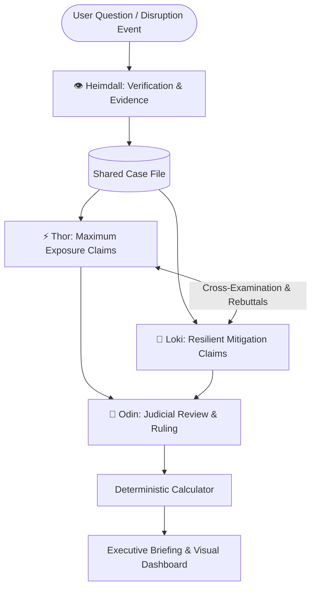

# ⚔️ XLR8 — Trial of the Nine Realms
### Autonomous Multi-Agent Adversarial Court for Supply Chain Disruption Analysis

[](https://www.python.org/downloads/)
[](https://fastapi.tiangolo.com/)
[](https://streamlit.io/)
[](LICENSE)

---

## 🏛️ Overview

**Trial of the Nine Realms** is an agentic AI system designed for real-time geopolitical and supply chain disruption analysis. Rather than trusting a single generative model, our system models a formal adversarial court where autonomous agents debate, cross-examine, and rule on trade exposure:

1. 👁️ **Heimdall (Verification & Discovery)**: Verifies event authenticity, filters out prompt injections and unverified rumors, and enforces temporal boundaries (`pub_date <= as_of`).
2. ⚡ **Thor (Prosecution / High Exposure)**: Discovers acute vulnerabilities, single-point bottlenecks, and maximum exposure scenarios.
3. 🐍 **Loki (Defense / Resiliency)**: Argues for mitigation, alternative routing, domestic reserves, and limited exposure.
4. 👑 **Odin (Supreme Magistrate)**: Conducts claim-by-claim rulings (Established, Contested, Conceded), computes deterministic mathematical ranges, and synthesizes the final executive briefing.

---

## 🏗️ Architecture



---

## 🚀 Quickstart

### 1. Installation
```bash
git clone https://github.com/Chawla-1/XLR8.git
cd XLR8
python -m venv venv
# On Windows:
.\venv\Scripts\activate
# On Linux/macOS:
source venv/bin/activate

pip install -r requirements.txt
```

### 2. Run Ingestion Tests
```bash
python -m tests.test_ingestion
```

## 👥 Team Contributions & Division of Work (Equal 25% Share)

| Member | Role & Ownership | Core Modules | Target % | GitHub Commits & PRs |
|---|---|---|:---:|---|
| **[Saksham Kumar](https://github.com/SakshamKumar4) (Person A)** | **Frontend & System Architecture** | `ui/app.py`, `src/api/`, `src/core/trace.py`, `README.md` | **25%** | `feat/frontend-and-docs` |
| **[Aaryan Chawla](https://github.com/Chawla-1) (Person B)** | **Data Ingestion & Search Engine** | `src/ingest/*`, `src/index/bm25.py`, `requirements.txt` | **25%** | `feat/data-layer` |
| **[Bhavneet Singh](https://github.com/Bhavneet31r) (Person C)** | **Judicial Magistrate & Schemas** | `src/core/schemas.py`, `src/agents/heimdall.py`, `src/agents/odin.py` | **25%** | `feat/heimdall-odin` |
| **[Yasharth Nagda](https://github.com/Yasharth-8) (Person D)** | **Adversarial Agents & Calc Engine** | `src/calc/*`, `src/agents/thor.py`, `src/agents/loki.py`, `src/brain/` | **25%** | `feat/thor-loki` |

> *Note: All members participate equally in multi-agent orchestration design, integration review, and system evaluation.*

