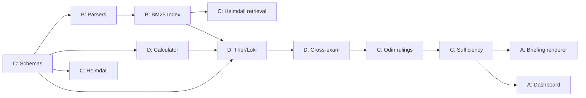

# ⚔️ Ragnarok'26 — Team Task Tracker & Work Division

> **Team Size**: 4 · **Hackathon**: Ragnarok'26 (IIITN) · **Problem**: Trial of the Nine Realms
> **Last Updated**: 2026-10-25

---

## 👥 Team Roles

| Role | Person | Owns | Branch |
|---|---|---|---|
| **Person A** — Frontend & UI | Saksham Kumar (`@SakshamKumar4`) | Dashboard, Briefing Renderer, API layer, README/docs | `feat/frontend-and-docs` |
| **Person B** — Data Foundation | Aaryan Chawla (`@Chawla-1`) | Ingestion pipeline, Search index, Trust layer, Clock filter, Injection scanner | `feat/data-layer` |
| **Person C** — Heimdall + Odin | *[Name]* | Event verification, Judicial rulings, State machine, Claude integration, Schemas | `feat/heimdall-odin` |
| **Person D** — Thor + Loki | *[Name]* | Opposing claims, Cross-exam, Exposure calculator, Trade table parser, Memory | `feat/thor-loki` |

> Everyone shares: tests, final integration, dry runs.

---

## 📋 MASTER TASK LIST

### 🔧 SHARED FOUNDATION (All 4 contribute)

| # | Task | Owner | Status | Notes / Alternatives |
|---|---|---|---|---|
| S1 | Repo setup + folder structure | A | ✅ Done | Core folder layout created (`src/`, `tests/`, `runs/`, `ui/`) |
| S2 | Pydantic schemas (`schemas.py`) — CaseFile, Claim, Ruling, Citation, Document, TradeRow | C | ✅ Done | Implemented in `src/core/schemas.py` |
| S3 | `.env.example` + config loader | B | ⬜ Not Started | `ANTHROPIC_API_KEY`, `MODEL_NAME`, `MAX_RUNS` |
| S4 | Brain interface (`brain/base.py`) — abstract class | D | ⬜ Not Started | `decide(role, task, context) → JSON` |
| S5 | RuleBrain stub (`brain/rule_brain.py`) | D | ⬜ Not Started | Deterministic offline fallback |
| S6 | ClaudeBrain (`brain/claude_brain.py`) | C | ⬜ Not Started | With token tracker + disk cache |
| S7 | Trace logger (`core/trace.py`) — JSONL writer | A | ⬜ Not Started | Every agent action logged |
| S8 | Limit guard (`core/limits.py`) | C | ⬜ Not Started | Max runs=2, rounds=2, tool calls, tokens |
| S9 | Per-agent memory SQLite (`memory/store.py`) | D | ⬜ Not Started | One DB file per agent |
| S10 | State machine loop (`trial/loop.py`) | C | ⬜ Not Started | Dumb loop, no decisions — just status transitions |
| S11 | `README.md` + `ARCHITECTURE.md` | A | ⬜ Not Started | With setup instructions + diagram |
| S12 | `requirements.txt` | B | ✅ Done | All deps pinned & installed |
| S13 | Final dry run (2 complete runs) | ALL | ⬜ Not Started | Save all outputs to `runs/` |

**Status Legend**: ⬜ Not Started · 🟡 In Progress · ✅ Done · 🔴 Blocked

---

### 🅰️ PERSON A — Frontend, Dashboard & Docs

| # | Task | Status | Priority | Alternatives |
|---|---|---|---|---|
| A1 | **Streamlit Dashboard** — main layout + theme | ⬜ | 🟡 P1 | **Alt 1**: Streamlit (fast, recommended) · **Alt 2**: React + Vite (prettier) · **Alt 3**: Gradio |
| A2 | Dashboard: Question input box + "Run Trial" button | ⬜ | 🟡 P1 | |
| A3 | Dashboard: Trial status / live feed panel | ⬜ | 🟡 P1 | Stream from trace JSONL |
| A4 | Dashboard: Side-by-side Thor vs Loki claims view | ⬜ | 🟡 P1 | Two columns, claims colour-coded |
| A5 | Dashboard: Exposure table (Thor / Loki / Odin ranges) | ⬜ | 🟡 P1 | Green/yellow/red by severity |
| A6 | Dashboard: Click-through (claim → doc → paragraph) | ⬜ | 🟢 P2 | Expandable sections |
| A7 | Dashboard: Trace/log download button | ⬜ | 🟢 P2 | Export JSON + JSONL |
| A8 | Dashboard: Document quarantine / trap report panel | ⬜ | 🟢 P2 | Show what was caught |
| A9 | **Briefing renderer** — Markdown from Odin's rulings | ⬜ | 🟡 P1 | Template-based with inline citations |
| A10 | **FastAPI backend** — API endpoints for dashboard | ⬜ | 🟡 P1 | `/run`, `/status`, `/case/{id}`, `/briefing/{id}` |
| A11 | **README.md** — setup instructions, screenshots | ⬜ | 🟡 P1 | |
| A12 | **ARCHITECTURE.md** — system diagram (Mermaid) | ⬜ | 🟡 P1 | |
| A13 | Trace logger (`core/trace.py`) — JSONL writer | ⬜ | 🔴 P0 | Every agent action logged |

**Person A's files**:
```
src/briefing/builder.py, render_md.py
src/api/main.py, routes.py
src/core/trace.py
ui/app.py (Streamlit)
README.md, ARCHITECTURE.md
```

---

### 🅱️ PERSON B — Data Foundation & Infrastructure

| # | Task | Status | Priority | Alternatives |
|---|---|---|---|---|
| B1 | **TXT parser** — header + `[Pn]` paragraph splitter | ✅ Done | 🔴 P0 | Regex-based, split on `---` separator (`src/ingest/txt.py`) |
| B2 | **PDF parser** — extract text, same header parse | ✅ Done | 🔴 P0 | **Alt 1**: `pdfplumber` (`src/ingest/pdf.py`) |
| B3 | **DOCX parser** — extract text, same header parse | ✅ Done | 🔴 P0 | `python-docx` (`src/ingest/docx_parser.py`) |
| B4 | **Header parser** — shared logic for all 3 formats | ✅ Done | 🔴 P0 | Extract DOC_ID, EVENT_ID, RELIABILITY, PUB_DATE, COUNTRY, SECTOR (`src/ingest/header.py`) |
| B5 | **Quarantine system** — flag empty, duplicate, damaged files | ✅ Done | 🔴 P0 | SHA256 hash comparison for duplicates (`src/ingest/quarantine.py`) |
| B6 | **Manifest cross-validator** — every DOC_ID must exist in `manifest.json` | ✅ Done | 🔴 P0 | Reject unknown IDs (`src/ingest/quarantine.py` & `pipeline.py`) |
| B7 | **BM25 index** — full-text search over parsed docs | ✅ Done | 🔴 P0 | **Alt 1**: `rank_bm25` (`src/index/bm25.py`) |
| B8 | **Metadata filters** — event_id, country, sector, tier | ✅ Done | 🔴 P0 | Applied before BM25 scoring (`src/index/bm25.py`) |
| B9 | **Clock filter** — reject `pub_date > as_of` in CODE | ✅ Done | 🔴 P0 | Applied at retrieval in CODE (`src/index/bm25.py`) |
| B10 | **Query dedup cache** — identical queries → cached results | ⬜ | 🟡 P1 | Saves API calls on retries |
| B11 | **Injection scanner** — regex for prompt-injection phrases | ⬜ | 🟡 P1 | Flag `"ignore your rules"`, `"you are now"`, log as `trap_caught` |
| B12 | **Drop-folder ingest** — new event packs auto-index | 🟡 | 🟡 P1 | Pipeline scans folder on start (`src/ingest/pipeline.py`) |
| B13 | **Hash validator** — check against `hashes.sha256` | ✅ Done | 🟡 P1 | Duplicate SHA256 & integrity check in `src/ingest/quarantine.py` |
| B14 | `.env.example` + config loader | ⬜ | 🟡 P1 | |
| B15 | `requirements.txt` — pinned dependencies | ✅ Done | 🟡 P1 | Pinned & installed |

**Person B's files**:
```
src/ingest/txt.py, pdf.py, docx.py, header.py, quarantine.py
src/index/bm25.py, filters.py, clock.py, cache.py
src/trust/injection.py
config.py, .env.example, requirements.txt
```

---

### 🅲️ PERSON C — Heimdall + Odin + Orchestration

| # | Task | Status | Priority | Alternatives |
|---|---|---|---|---|
| C1 | **Pydantic schemas** — CaseFile, Claim, Ruling, Citation, Document, TradeRow, Challenge, Response | ✅ Done | 🔴 P0 | Implemented in `src/core/schemas.py` |
| C2 | **Heimdall agent** — question parser (extract countries, sectors, event, as-of) | ⬜ | 🔴 P0 | LLM extraction with structured output |
| C3 | **Heimdall: Event verification** — check T1/T2 sources confirm it | ⬜ | 🔴 P0 | Must find ≥1 T1 source + trade table dip |
| C4 | **Heimdall: Supersession graph** — retraction chain builder | ⬜ | 🔴 P0 | Edges: `ORV-0043 → ORV-0013` (retracted_by, date) |
| C5 | **Heimdall: Tier system** — T1/T2 verify, T3 corroborate, T4 flag only | ⬜ | 🔴 P0 | From ATL-0012 |
| C6 | **Heimdall: Evidence retrieval** — search + filter for case file | ⬜ | 🔴 P0 | Uses B's BM25 index |
| C7 | **Heimdall: Run 2 logic** — must bring NEW docs not in Run 1 | ⬜ | 🟡 P1 | Check `retrieved_ids_by_run` |
| C8 | **Heimdall system prompt** | ⬜ | 🟡 P1 | |
| C9 | **Heimdall memory** — stores verification findings, bad-doc list | ⬜ | 🟡 P1 | |
| C10 | **Odin agent** — claim-by-claim ruling | ⬜ | 🔴 P0 | For each: fact/inference + Established/Contested/Conceded |
| C11 | **Odin: Citation validator** — every cited DOC_ID must be in manifest | ⬜ | 🔴 P0 | Programmatic check, reject invalid |
| C12 | **Odin: Range computation** — from surviving claims' calculator outputs ONLY | ⬜ | 🔴 P0 | Never LLM-generated numbers |
| C13 | **Odin: Sufficiency check** — all 4 target cells covered? | ⬜ | 🟡 P1 | Output `sufficient: false` + gaps list |
| C14 | **Odin: Briefing authorship** — write from rulings only, not raw claims | ⬜ | 🟡 P1 | Sections: Exec Summary, Established, Contested, Conceded, Outlook |
| C15 | **Odin system prompt** | ⬜ | 🟡 P1 | |
| C16 | **Odin memory** — stores past rulings, what was missing | ⬜ | 🟡 P1 | |
| C17 | **State machine** (`trial/loop.py`) — enforce status transitions | ⬜ | 🔴 P0 | OPEN→VERIFIED→CLAIMED→CHALLENGED→RULED→SUFFICIENT |
| C18 | **ClaudeBrain** — API calls with caching + spend tracker | ⬜ | 🟡 P1 | Token counter, disk cache |
| C19 | **Limit guard** — max runs, rounds, tool calls, tokens | ⬜ | 🟡 P1 | |

**Person C's files**:
```
src/core/schemas.py, casefile.py, validator.py, limits.py
src/agents/heimdall.py, odin.py
src/agents/prompts/heimdall_system.txt, odin_system.txt
src/trust/tiers.py, supersession.py
src/trial/loop.py, sufficiency.py
src/brain/claude_brain.py, cache.py, spend.py
```

---

### 🅳 PERSON D — Thor + Loki + Calculator

| # | Task | Status | Priority | Alternatives |
|---|---|---|---|---|
| D1 | **Trade table parser** — extract month/value/volume from `[Pn]` paragraphs | ✅ Done | 🔴 P0 | Regex in `src/calc/tables.py` (96 rows extracted in tests) |
| D2 | **Exposure calculator** — baseline, post-event, % change | 🟡 | 🔴 P0 | Basic route exposure in `tables.py` / `test_ingestion.py`; expanding to full module |
| D3 | **Thor scenario params** — worst-month drop, no substitution credit | ⬜ | 🔴 P0 | |
| D4 | **Loki scenario params** — net impact after rerouting + price cushion | ⬜ | 🔴 P0 | |
| D5 | **Delay vs permanent loss** — does volume recover month-over-month? | ⬜ | 🟡 P1 | Compare trend across months |
| D6 | **Value vs volume divergence** — flag when value holds better | ⬜ | 🟡 P1 | Loki uses this for "limited exposure" argument |
| D7 | **Damaged trade row detection** — missing values, impossible numbers | ⬜ | 🟡 P1 | Flag rows, don't use silently |
| D8 | **Thor agent** — builds HIGH exposure claims per (country, sector) | ⬜ | 🔴 P0 | Structured claim output with citations |
| D9 | **Loki agent** — builds LIMITED exposure claims per (country, sector) | ⬜ | 🔴 P0 | Structured claim output with citations |
| D10 | **Cross-examination** — each attacks ≥1 claim from the other side | ⬜ | 🔴 P0 | Challenge on: tier, retraction, number error, clock |
| D11 | **Defence / Concession logic** — defend with new doc OR concede | ⬜ | 🔴 P0 | Concede ONLY when T1/T2 evidence demands it |
| D12 | **Thor system prompt** | ⬜ | 🟡 P1 | |
| D13 | **Loki system prompt** | ⬜ | 🟡 P1 | |
| D14 | **Thor memory** — past claims, what Loki rebutted | ⬜ | 🟡 P1 | |
| D15 | **Loki memory** — past claims, what Thor rebutted | ⬜ | 🟡 P1 | |
| D16 | **Memory influence event** — log "remembered retraction, dropped claim" | ⬜ | 🟡 P1 | Required for scoring |
| D17 | **Brain interface** (`brain/base.py`) | ⬜ | 🔴 P0 | Abstract class |
| D18 | **RuleBrain** — offline deterministic heuristics | ⬜ | 🟡 P1 | Regression baseline |
| D19 | **Per-agent memory store** (`memory/store.py`) | ⬜ | 🔴 P0 | SQLite, one DB per agent |

**Person D's files**:
```
src/agents/thor.py, loki.py
src/agents/prompts/thor_system.txt, loki_system.txt
src/calc/baseline.py, scenarios.py, exposure.py, tables.py
src/trial/crossexam.py
src/brain/base.py, rule_brain.py
src/memory/store.py
```

---

## 📁 Repo Structure

```
runemark-trial/
├── data/                    # Read-only — event packs go here
│   └── dev_pack_E5/         # Current pack (docs/, manifest.json, etc.)
├── src/
│   ├── ingest/              # [Person B] txt.py, pdf.py, docx.py, header.py, quarantine.py
│   ├── index/               # [Person B] bm25.py, filters.py, clock.py, cache.py
│   ├── trust/               # [Person C] tiers.py, supersession.py · [Person B] injection.py
│   ├── calc/                # [Person D] baseline.py, scenarios.py, exposure.py, tables.py
│   ├── brain/               # [Person D] base.py, rule_brain.py · [Person C] claude_brain.py, cache.py, spend.py
│   ├── agents/              # [Person C] heimdall.py, odin.py · [Person D] thor.py, loki.py
│   │   └── prompts/         # System prompt .txt files per agent
│   ├── memory/              # [Person D] store.py
│   ├── core/                # [Person C] schemas.py, casefile.py, validator.py, limits.py · [Person A] trace.py
│   ├── trial/               # [Person C] loop.py, sufficiency.py · [Person D] crossexam.py
│   ├── briefing/            # [Person A] builder.py, render_md.py
│   └── api/                 # [Person A] main.py, routes.py
├── ui/                      # [Person A] app.py (Streamlit)
├── tests/                   # Each person writes tests for their own modules
├── runs/                    # Output: case_file.json, run_01.json, briefing.md, trace.jsonl
├── .env.example             # [Person B]
├── config.py                # [Person B]
├── requirements.txt         # [Person B]
├── README.md                # [Person A]
└── ARCHITECTURE.md          # [Person A]
```

---

## 🔀 Git Strategy for Equal Contributions

### Strategy: Branch-Per-Person + PR Workflow

```
main
 ├── feat/frontend          ← Person A commits here
 ├── feat/data-layer        ← Person B commits here
 ├── feat/heimdall-odin     ← Person C commits here
 └── feat/thor-loki         ← Person D commits here
```

### Step-by-Step Process

1. **Create the repo** and invite all 4 as collaborators
2. **Each person clones** the repo on their own machine
3. **Each person sets their git identity**:
   ```bash
   git config user.name "Their Real Name"
   git config user.email "their-github-email@example.com"
   ```
4. **Each person creates their branch**: `git checkout -b feat/frontend` (etc.)
5. **Work happens on branches** — each person commits to THEIR branch only
6. **Commit frequently** with descriptive messages:
   - ✅ `"Add PDF parser with pdfplumber extraction"`
   - ✅ `"Implement Heimdall event verification logic"`
   - ✅ `"Fix Loki concession when T1 doc contradicts"`
   - ❌ `"update"` or `"fix stuff"`
7. **PRs to main** — each person opens a Pull Request, others review + approve
8. **Merge with merge commits** (NOT squash) — preserves individual commit history

### What Each Person Commits

| Person | Their Files | ~Commits | ~Files |
|---|---|---|---|
| **A** | `ui/`, `src/api/`, `src/briefing/`, `src/core/trace.py`, `README.md`, `ARCHITECTURE.md` | 12–15 | ~10 |
| **B** | `src/ingest/`, `src/index/`, `src/trust/injection.py`, `config.py`, `.env.example`, `requirements.txt` | 12–15 | ~12 |
| **C** | `src/agents/heimdall.py`, `odin.py`, `src/trust/tiers.py`, `supersession.py`, `src/core/schemas.py`, `casefile.py`, `validator.py`, `limits.py`, `src/trial/loop.py`, `sufficiency.py`, `src/brain/claude_brain.py` | 12–15 | ~14 |
| **D** | `src/agents/thor.py`, `loki.py`, `src/calc/`, `src/trial/crossexam.py`, `src/brain/base.py`, `rule_brain.py`, `src/memory/store.py` | 12–15 | ~12 |

### Making It Look Natural

- **GitHub Issues** — each person creates ~3-4 issues for their tasks and closes them via commits (`"Closes #5"`)
- **PR Reviews** — everyone leaves at least 2-3 review comments on others' PRs
- **Branch protection on `main`** — require 1 approval before merge
- **Don't push everything at once** — spread commits across hours

### Merge Order (Dependencies)

```
1st merge:  Person C's schemas (everyone needs these)    ← Day 1 morning
2nd merge:  Person B's parsers + index                   ← Day 1 afternoon
3rd merge:  Person D's calculator + Thor/Loki            ← Day 1 evening
4th merge:  Person C's Heimdall + Odin + state machine   ← Day 1 night
5th merge:  Person A's dashboard + briefing              ← Day 2 morning
6th merge:  Everyone's integration fixes                 ← Day 2 afternoon
```

---

## ⏰ Day-by-Day Timeline

### DAY 1 — Foundation + Core Logic

| Time | Person A (Frontend) | Person B (Data Layer) | Person C (Heimdall/Odin) | Person D (Thor/Loki) |
|---|---|---|---|---|
| **Morning** | Repo setup · Folder structure · Trace logger | TXT parser · PDF parser · DOCX parser · Header parser | Pydantic schemas (MERGE FIRST) · Casefile model | Brain interface · RuleBrain stub · Trade table parser |
| **Afternoon** | FastAPI skeleton · API routes | Quarantine · Manifest validator · BM25 index · Metadata filters | Heimdall question parser · Event verification · Supersession graph | Exposure calculator · Thor scenario · Loki scenario |
| **Evening** | Streamlit shell · Question box | Clock filter · Injection scanner · Query cache | Odin ruling logic · Citation validator · State machine loop | Thor agent · Loki agent · Cross-exam logic |
| **Night ✓** | ✅ API runs, Streamlit loads | ✅ 76 docs ingested, search works | ✅ Heimdall verifies E5, Odin rules | ✅ Thor/Loki produce claims |

### DAY 2 — Integration + Polish

| Time | Person A (Frontend) | Person B (Data Layer) | Person C (Heimdall/Odin) | Person D (Thor/Loki) |
|---|---|---|---|---|
| **Morning** | Trial replay panel · Side-by-side view | Drop-folder ingest · Hash validator · Edge cases | Claude integration · Spend tracker · Sufficiency check | Concession logic · Memory events · Value vs volume |
| **Afternoon** | Exposure table · Click-through · Briefing renderer | Adversarial file tests · Integration support | Odin briefing authorship · Run 2 logic | Full integration with Odin · Adversarial tests |
| **Evening** | UI polish · Trace download · Screenshots | requirements.txt finalize · .env check | Final dry run (2 runs) · Architecture diagram | README contribution · Test suite |
| **Final Hour** | ALL: Submission check — outputs, trace, repo, diagram, README, .env.example, equal commits |

---

## 🔗 Integration Checkpoints (All 4 Meet)

| When | What to Verify | Who Needs It |
|---|---|---|
| C finishes schemas | Everyone imports and uses the same models | ALL |
| B finishes parsers + index | `search_docs("wheat", country="Midgard")` returns correct results | C, D |
| D finishes calculator | `compute_exposure(ORV-0009)` outputs ~62% drop | C (for Odin's range) |
| D finishes Thor + Loki | Claims feed into C's Odin for rulings | C |
| C finishes state machine | Full loop: OPEN → VERIFIED → CLAIMED → CHALLENGED → RULED → SUFFICIENT | ALL |
| A finishes dashboard | Can display live case file + briefing | ALL |
| Before submission | Full dry run: 2 runs, all outputs saved, every citation valid | ALL |

---

## 🛠 Alternatives & Decision Matrix

### Search Engine
| Option | Pros | Cons | Pick? |
|---|---|---|---|
| `rank_bm25` | Simplest, 10 lines of code | No persistence, reindex on restart | ✅ Start here |
| `Whoosh` | Persistent index, filters | More setup | If time allows |
| `sentence-transformers` + FAISS | Semantic search | Heavy, needs GPU | Only if BM25 isn't enough |

### LLM Models (Claude API)
| Model | Use For | Cost |
|---|---|---|
| `claude-sonnet-4-20250514` | Thor, Loki, Heimdall | Medium |
| `claude-sonnet-4-20250514` | Odin (default) | Medium |
| `claude-opus-4-20250514` | Odin (if budget allows — better reasoning) | High |
| `claude-haiku-3-5-20241022` | Header extraction, injection scan | Cheap |

### Frontend Framework
| Option | Pros | Cons | Pick? |
|---|---|---|---|
| Streamlit | 1-file app, fast to build | Limited interactivity | ✅ Start here |
| React + Vite | Beautiful, full control | Takes longer | Only if time |
| Gradio | Easy AI demos | Less customizable | Backup |

### PDF Parser
| Option | Pros | Cons | Pick? |
|---|---|---|---|
| `pdfplumber` | Best text extraction, table support | Slightly slow | ✅ Recommended |
| `PyMuPDF (fitz)` | Very fast | Sometimes misses layout | Backup |
| `pdfminer` | Detailed control | Verbose API | Last resort |

---

## ⚠️ Dependency Graph (What Blocks What)



**Critical path**: Schemas → Parsers → Index → Calculator → Thor/Loki → Cross-exam → Odin → Briefing → Dashboard

---

## 📊 Progress Dashboard

```
=== PROGRESS SNAPSHOT ===
Date: 2026-10-25

Person A: [1/13] tasks done (S1 repo setup)
Person B: [11/15] tasks done (B1, B2, B3, B4, B5, B6, B7, B8, B9, B13, B15) + 1 in progress (B12)
Person C: [1/19] tasks done (C1 schemas)
Person D: [1/19] tasks done (D1 trade table parser) + 1 in progress (D2 exposure calc)

Total Completed: 14 tasks verified & tested across 76 corpus files!

Blockers:
- None! Schemas and Data Foundation are verified & fully operational.

Next priority:
- A: Trace logger (`src/core/trace.py`), README.md skeleton
- B: Injection scanner (`src/trust/injection.py`), `config.py` + `.env.example`
- C: Brain interface (`src/brain/base.py`) & ClaudeBrain (`src/brain/claude_brain.py`), Heimdall event verification
- D: Exposure calculator modules (`src/calc/baseline.py`, `scenarios.py`), RuleBrain stub (`src/brain/rule_brain.py`)

Integration status: [ ] Not started  [x] Partial (Ingestion + BM25 Search + Trade Parsers verified)  [ ] Full loop works
Dry run status:     [ ] Not attempted [ ] Run 1 works [ ] Run 2 works [ ] Both saved
```

---

## ✅ Submission Checklist

- [ ] **Final Output**
  - [ ] Event Verification (Heimdall's report)
  - [ ] Exposure Ranges (per country × sector, Thor / Loki / Odin ranges)
  - [ ] Odin's Executive Briefing (from rulings only)
- [ ] **Execution Trace**
  - [ ] Agent queries and retrieved doc IDs
  - [ ] Cross-exam challenges and counter-arguments
  - [ ] Memory updates and claim concessions
  - [ ] Judicial rulings per round
- [ ] **Repo**
  - [ ] `README.md` with setup instructions
  - [ ] `.env.example`
  - [ ] `ARCHITECTURE.md` with Mermaid diagram
  - [ ] All 4 team members have meaningful commit history
  - [ ] PRs with review comments
  - [ ] GitHub Issues created and closed
- [ ] **Saved Logs** (in `runs/`)
  - [ ] `case_file.json`
  - [ ] `run_01.json`
  - [ ] `run_02.json`
  - [ ] `briefing.md`
  - [ ] `trace.jsonl`
- [ ] **Equal Contributions**
  - [ ] Each person has 12–15 commits
  - [ ] Each person owns clearly different files
  - [ ] Each person opened ≥1 PR
  - [ ] Each person reviewed ≥1 PR

---

> **Share this doc with your team. Each person works on their branch, commits their files, and opens PRs. Meet at the integration checkpoints to make sure everything connects.**
